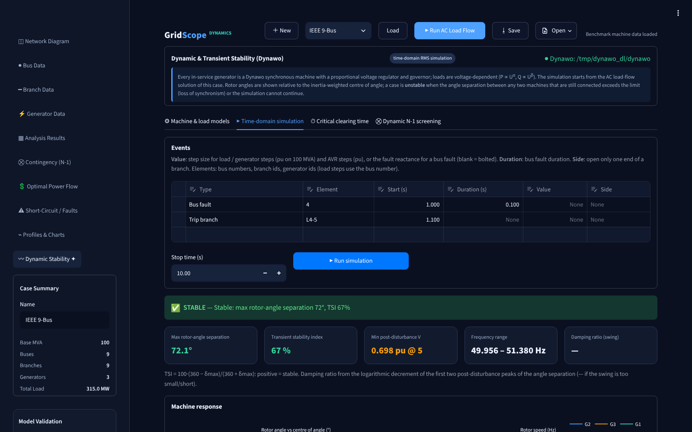
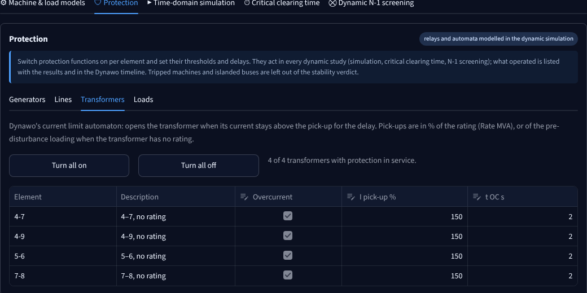
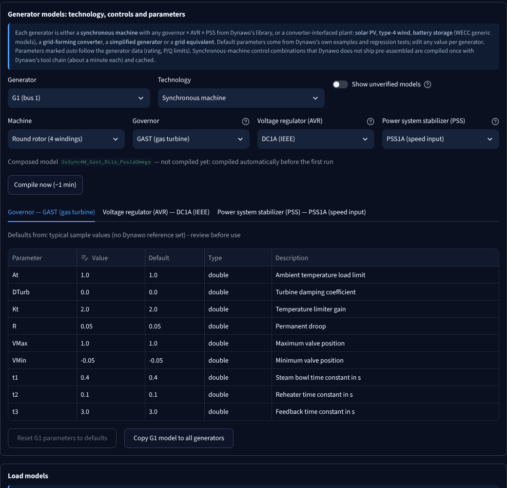
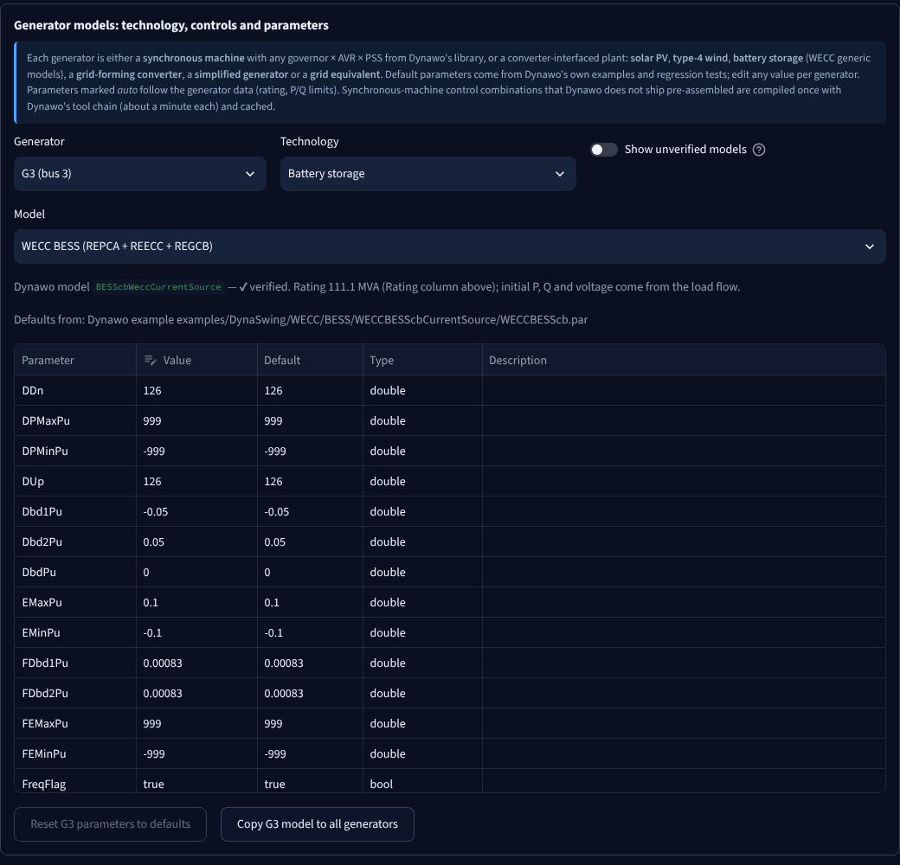

# GridScope Dynamics

GridScope's power-system analysis workflow, rebuilt in Python with **dynamic and transient stability studies** added.

The app keeps GridScope's layout and study flow: header toolbar, sidebar navigation with case summary and live model validation, the same nine views, the same table columns, and the same **GridScope JSON case format**. Networks saved by the GridScope web app open here unchanged, and networks saved here open in GridScope. A tenth view, **Dynamic Stability**, runs time-domain simulations with [Dynawo](https://dynawo.github.io/) through PowSyBl.



---

## Quick start

**Ubuntu / Debian (scripted):**

```bash
./setup_gridscope.sh            # system packages, .venv, Dynawo v1.7.0, PowSyBl config, checks
./run_gridscope.sh              # starts the app and opens it in the browser
```

`setup_gridscope.sh` installs Dynawo into `vendor/dynawo` inside the project and writes `~/.itools/config.yml` (the only file outside the project — pypowsybl reads its configuration from there). Re-running it skips whatever is already done; `--tests` runs the test suite afterwards, `--help` lists the options. Run it again after moving the project folder.

**By hand:**

```bash
pip install -r requirements.txt
streamlit run app.py
```

The app opens at <http://localhost:8501>. Everything except Dynamic Stability works without Dynawo.

**For Dynamic Stability**, install Dynawo (tested with v1.7.0) and point PowSyBl at it in `~/.itools/config.yml`:

```yaml
dynawo:
  homeDir: /path/to/the/folder/containing/dynawo.sh
  debug: false
```

The Dynamic Stability view shows whether Dynawo was found.

To use governor / AVR / PSS combinations that Dynawo doesn't ship pre-assembled, also install a C/C++ compiler and CMake (`sudo apt install build-essential cmake`). Those combinations are compiled once on first use.

---

## Views

| View | GridScope | Here (engine) |
|---|---|---|
| Network Diagram | SVG single-line diagram, inspector, solver options, log | Same, plus a **Standard** drawing style (bus bars, two-circle transformers, generator / load / shunt symbols) next to GridScope's **Schematic** style, **animated power-flow arrows** (P or Q, after an AC load flow), a **diagram editor** (✎ Edit: move buses, add / delete elements, edit properties, build a network from scratch), and a **dynamic replay**: bus voltages over time with tripped branches drawn open |
| Bus / Branch / Generator Data | Editable, sortable tables | Same columns. Add rows at the bottom, select rows + Delete to remove |
| Analysis Results | AC Newton–Raphson, Q-limit PV→PQ switching | **PowSyBl OpenLoadFlow**, configured to behave like GridScope (below), plus a **Generator Results** table: final P/Q per generator, ΔP vs schedule, voltage vs set-point, limit flags |
| Contingency (N-1) | DC and AC branch-outage screening | **PowSyBl security analysis**, DC or AC, with islanding detection |
| Optimal Power Flow | DC-OPF QP with LMPs | Same formulation, solved with **cvxpy / Clarabel** |
| Short-Circuit / Faults | IEC 60909 / ANSI, 3ph/SLG/LL/LLG, K_G/K_T, min/max case | **numpy port of GridScope's own engine** |
| Profiles & Charts | Voltage magnitude and angle | Same, plus branch loading |
| **Dynamic Stability** ✦ | *(roadmap item in GridScope)* | **Dynawo** via `pypowsybl.dynamic` |

### Power-flow arrows

After an AC load flow, animated arrows on every in-service line and transformer show which way power flows; the **flow Off / P / Q** switch in the diagram's toolbar chooses real or reactive power (it switches instantly and is remembered). Arrows move faster on lines carrying more, and each branch is labelled with its sending-end value (MW or MVAr).

Each half of a branch follows the flow at its own end. Real power always reads as one direction; reactive power can point *out of both ends* — a lightly loaded line exporting its charging MVAr — or *into both ends* (a heavily loaded line absorbing MVAr), and the label then shows both end values (e.g. `26.3 | 7.9 MVAr`). Arrows are hidden when the load-flow results are out of date (the model changed) and during the dynamic-simulation replay; with the system's *reduce motion* setting the arrows are drawn still.

The diagram toolbar also has **⛶ maximize** — the diagram area (with its style / overlay / edit controls, legend and the Selected Element panel) fills the browser window; ⛶ again or Esc restores the layout — and **⭳ PNG download** — the diagram as shown, at twice the screen resolution, with the flow values and a caption naming the case and the flow quantity. Running the AC load flow no longer switches to the results tables: the results appear on the diagram (bus voltages, loading colours, flow arrows), and the tables stay one click away under **Analysis Results**. If the load flow fails, the app goes to the Network Diagram, whose Solver Log explains why.

### Editing the network in the diagram

Turn on **✎ Edit** above the Single-Line Diagram (works in both the Schematic and the Standard style):

* **Move**: drag a bus; its symbols and branches follow, and the layout is redrawn when you let go. **Snap** rounds positions to a grid.
* **Add**: pick a tool in the diagram's toolbar — bus (click an empty spot), line or transformer (click two buses), generator, load or shunt (click a bus). A new bus takes the voltage level of the nearest bus; the first bus of an empty network is the Slack bus; adding a generator to a PQ bus makes it a PV bus. Esc returns to the select tool.
* **Edit properties**: click any bus, line, transformer or generator; its fields (impedances, ratings, tap, loads, shunts, set-points, limits, status) are editable in the **Selected Element** panel.
* **Delete**: select an element and press **Del** (or 🗑). Deleting a bus also removes its branches and generators.
* **Undo**: ↶ or Ctrl+Z, for diagram and panel edits.
* Pan by dragging the background, zoom with the mouse wheel, ⤢ fits the view.

Every edit goes through the same validation as the data tables (sidebar), and results computed before it are marked out of date. Positions are the bus `x` / `y` of the GridScope JSON, so a network built here still opens in GridScope. To build from scratch: **＋ New**, then ✎ Edit.

### Dynamic Stability

* **Machine & load models.**
  * **Generator data** (rating, H, Xd, X′d, X″d, Xq, T′d0, T″d0) is edited per generator. Missing values use typical data scaled to the machine rating. **Load benchmark data** applies the WSCC data (Anderson & Fouad) to IEEE 9, and the New England inertia constants to IEEE 39.
  * **Generator models**: per generator, pick the **technology** and then the model (see *Generator models* below):
    * synchronous machine (round rotor or salient pole) with **any governor × any AVR × any PSS** from Dynawo's library;
    * solar PV, type-4 wind or battery storage (WECC generic models);
    * grid-forming converter (droop, matching, dispatchable virtual oscillator);
    * simplified generator (GeneratorPQ / GeneratorPV) or grid equivalent (infinite bus, inertial grid).
    Every parameter can be edited.
  * **Load models**: a default Dynawo load model for all loads plus optional per-bus overrides — exponential (α/β), restorative, two-motor fifth-order, ZIP, constant PQ, electronic load. The default is P ∝ U^α, Q ∝ U^β with α = β = 2 (constant impedance).
  * Choose the solver: simplified fixed-step (default) or IDA.
  * Everything is saved in the network JSON. Per generator: `generator.dyn` (`model`, machine data, `controls`, `source`, `sourceParams`). Study-wide: `dynamicSettings`, which holds the study settings (α, β, angle limit, frequency, solver), load models (`loadModel`, `loadParams`, `loadModels`), `protection`, the simulation `events` (including disabled ones) and `stopTime`, and the critical clearing time (`cct`) and N-1 screening (`screening`) inputs. The original GridScope ignores both.
* **Time-domain simulation.** Each event has an **On** box: untick it to leave the event out of a run without deleting it. Events: bus fault (bolted or with reactance), line fault (at any point along a line, see below), branch trip (one or both ends), generator trip, load ΔP/ΔQ step, generator ΔP setpoint, AVR setpoint step. Outputs: rotor angles relative to the centre of angle, speed, P, Q (also for converters), field voltage, mechanical power, bus voltages, the Dynawo timeline, and a stable/unstable verdict. Metrics: maximum angle separation, transient stability index (TSI), minimum post-disturbance voltage, frequency range, and swing damping ratio.
* **Choosing what is plotted.** Under *Machine response* and *Bus voltages*, pick the generators and buses to show; **All**, **Top 8** / **Top 6** (the most disturbed: lost units, then the largest rotor-angle and power swings; or the lowest voltages) and **Clear** set the list in one click. Systems with up to 10 generators start with all shown; larger ones (IEEE 39, 118) start with the 8 most disturbed. Each generator keeps its colour whatever else is shown, and clicking a name in the legend still hides it for a moment.
* **Line faults.** Type *Line fault*, Element = the line, **At (%)** = distance from the line's *from* end (blank = 50 %), Duration = fault duration, Value = fault reactance (blank = bolted).
  * The line is split at the fault point for that run: a temporary bus `line@x%` between two sections, impedance and charging shared in proportion. Its voltage appears in the results; it is left out of the stability metrics and the islanding report.
  * By default the line opens at both ends when the fault clears. Side **NONE** leaves the fault on for its duration and lets the line protection clear it. With distance protection, a fault near one end trips that end in zone 1 (breaker time only) and the far end in zone 2.
  * The relays keep their settings for the whole line (reaches are a share of the whole line's reactance); each section keeps only the relay at its real line end. A trip branch event on the line opens the matching section ends.
  * Protection operations are reported against the original line.
* **Critical clearing time.** Bisection on the duration of a bolted three-phase fault at a chosen bus, optionally cleared by tripping a branch. Shows every trial and the rotor angles either side of the boundary.
* **Dynamic N-1 screening.** For each selected branch: a fault at one end, cleared by tripping that branch. Gives a verdict, TSI, minimum voltage and damping per contingency, and flags islanding. Any row can be replayed in full.

### Protection



The **🛡 Protection** tab switches protection on per element and sets its thresholds and delays. Protection acts in every dynamic study (simulation, critical clearing time, N-1 screening). What operated is listed under **Protection operations** with the results, and Dynawo's own messages appear in the timeline. Tripped machines and islanded buses are left out of the stability verdict.

| Element | Functions | Dynawo model |
|---|---|---|
| Generators (synchronous) | Over/under speed (Hz, delay) · under-voltage · over-voltage · loss of synchronism (internal-angle limit) | `SpeedProtection`, `UVA`, `OVA`, `LossOfSynchronismProtection`, combined in one relay (`GsGeneratorProtection`) compiled into the machine model, tripping it through its third switch-off signal |
| Lines | Two-zone quadrilateral distance at both ends (reaches in % of the line impedance, R reach, zone delays, breaker time) · definite-time overcurrent (% of rating) | `DistanceProtectionLineTwoZones` ×2 inside `GsLineProtected` (Dynawo's PI `Line` + relays) |
| Transformers | Definite-time overcurrent / overload (% of rating) | `CurrentLimitAutomaton` (pypowsybl overload management system) |
| Loads | Under-frequency load shedding, 3 steps (Hz, % shed, delay; system frequency from OmegaRef, or measured at the bus when line protection is on) · under-voltage load shedding | `UFLS3Steps` inside `GsLoadShedding` / `GsLoadSheddingLocal` (the α/β load + shedding) |

**How it is wired**
* **GridScope's own Modelica classes** (`gridscope/modelica`) combine Dynawo's protection models with the elements they act on. They are compiled once with the same tool chain as the composed controls, and rebuilt automatically when the classes change.
* **Line protection forces a full Modelica network.** Once a line has a Modelica model, pypowsybl requires one on every branch and bus. So when any line protection is on:
  * all lines use `GsLineProtected`, with protection off where not chosen;
  * transformers use `GsNetworkTransformer`: Dynawo's `NetworkTransformer` plus the branch state that trip events act on, and its own overcurrent relay (it replaces the current limit automaton in this mode);
  * buses use `Bus`;
  * shunts become constant-impedance loads drawing the same reactive power at the solved voltage, because pypowsybl's Modelica shunt cannot report its final state;
  * pypowsybl no longer provides a system frequency (OmegaRef), only a constant set-point. Load shedding then uses `GsLoadSheddingLocal`, which measures frequency at the load bus from the rate of change of the filtered voltage angle (filters 0.05 s and 0.1 s, so angle jumps after switching don't trip it). It operates a little later than with the system frequency (about 0.15 s in tests).
* **Limits of the full Modelica network:**
  * runs are slower;
  * cases with phase-shifting transformers can't use line protection (Dynawo's Modelica transformer has no phase shift);
  * cases with WECC converter models (PV, wind type 4 with plant control, battery) or grid-forming converters can't use line protection: their frequency input can't be connected to pypowsybl's constant set-point in Dynawo 1.7, and the run would produce no output.
  * In both cases the run goes ahead without line protection, and the results say why.
* **pypowsybl 1.16 and Dynawo 1.7 don't agree on how a Modelica branch is switched.** pypowsybl drives a `state` connector that Dynawo 1.7's line and transformer models lack, so trip events failed. The GridScope line and transformer provide it:
  * opening one end keeps the line energised from the other end, as the network model does;
  * results with and without the Modelica network agree for faults, line trips, one-end trips and transformer trips (tested);
  * the only difference is an islanded bus that still has a generator: the Modelica network keeps it energised instead of de-energising it.
* **A distance trip at either end opens the whole line.** The relays measure each end's voltage and power. During initialisation and after a trip they see a neutral far-away impedance.
* **Pick-up base:** with no rating (Rate MVA), overcurrent pick-ups are a percentage of the pre-disturbance loading, and the results say so.

**Verified** (`tests/test_protection.py`, IEEE 9 with WSCC data at 60 Hz):
* A 0.5 s busbar fault at bus 7 is cleared by zone 2 at the remote ends of both adjacent lines at 1.36 s (0.3 s + 0.06 s breaker).
* Line overcurrent trips at its delay.
* A 2 s fault trips G3 on under-voltage at 2.5 s.
* A 0.4 s fault makes G3 slip poles: it is tripped by loss of synchronism, and the rest of the system stays stable.
* An overloaded T2 opens and islands G2.
* Losing G2 sheds load in three UFLS steps (10/20/30 %).
* IEEE 14 with line protection (shunts → impedance loads) still starts flat.

### Generator models

#### Synchronous machines: any governor × AVR × PSS



Dynawo runs *pre-assembled* models: one compiled library per machine + controls combination. It ships 33 of them for pypowsybl. GridScope offers every controller class in Dynawo's library instead — **11 governors, 32 AVRs and 9 PSSs**, on a round-rotor or salient-pole machine, in any combination (or none).

* If Dynawo ships the chosen combination and it passed verification, it is used directly. Otherwise the controls are composed (some shipped models, such as TGOV1 + SEXS without a PSS, don't start in Dynawo 1.7).
* **Set-point steps** (Generator ΔP setpoint, AVR setpoint step): pypowsybl sends these events only to Dynawo's proportional-regulation machines. Composed machines (and every machine with generator protection, which is composed) carry a small GridScope block, `GsSetpoints`, that applies them instead:
  * the power step goes to the governor's reference input (pu of the turbine rating; TGOV1's reference is scaled by its droop R);
  * the voltage step is applied where the AVR measures the stator voltage, which acts on its error exactly as raising the reference;
  * one step of each kind per generator per run;
  * GOVCT2, GOVSTEAM1, GOVSTEAMEU, GOVHYDRO4, HYGOV, IEEEG1 and the Nordic governor compute their initial reference internally, so they take no power step. Neither do the other shipped library models. In both cases the results say the step was not applied.
* Otherwise GridScope writes the model definition and compiles it once with Dynawo's own tool chain (`generate-preassembled`, then `dumpModel`). This takes about a minute and is cached in `vendor/gridscope_cache` inside the project (override with `GRIDSCOPE_DYNAWO_CACHE`). The model is registered with pypowsybl through the merged model directory (`DYNAWO_DDB_DIR`) and its `additionalModelsFile` parameter.
* Compilation runs automatically before the first simulation that needs it, or from **Compile now** in the editor.
* **Requirements**: a C/C++ compiler and CMake (Debian/Ubuntu: `sudo apt install build-essential cmake`).
* Your Dynawo folder is never modified. Compilation uses a symbolic-link copy of it in the cache, with one Boost header patched for glibc ≥ 2.34 (Dynawo 1.7.0's bundled Boost doesn't build against newer glibc otherwise).

How each controller is wired to the machine (connections, initialisation model, PSS input/output) is harvested from Dynawo's own ~240 pre-assembled model definitions. For the 13 classes Dynawo never pre-assembles, the wiring is inferred from the class interface (`.extvar`) and its initialisation model (`tools/composition_catalog.py`).

**Default parameter values**, in order of preference:
1. Dynawo's regression tests and examples (including two newer AC1C/PSS1A test cases from Dynawo's development branch).
2. The IEEE RTS example tables.
3. The closest relative's reference set (e.g. ST4C from ST4B, AC6C from AC6A).
4. For GAST, IEEEG2, DC1A/DC1C, IEEEX2/IEEEX2A, ST1A/ST1C and BBSEX1: typical IEEE 421.5 / PSS®E-style sample values. These are labelled *typical sample values — review before use* in the editor.

Each component shows its source. **Parameters with physical units** (PSS rating, governor nominal power, simplified governor P limits) are filled from each machine automatically and shown as *auto*. **Governor limits** below the initial loading are raised, and the simulation reports this.

**Verification.** `tools/verify_composition.py` compiles and runs every class in a representative combination on IEEE 9 (WSCC data) and IEEE 14:
* each governor with SEXS (hydro governors on a salient-pole machine);
* each AVR with TGOV1;
* each PSS with TGOV1 + SEXS.

A class is **verified** only if a 5 s flat start holds equilibrium (|ΔP| < 0.5 MW, |ΔV| < 1e-3 pu), and a fault with a line trip, a line trip alone, and a load step each run to the end. With Dynawo 1.7.0, **37 of 52** classes pass:

| | Verified | Unverified (shown with **Show unverified models**) |
|---|---|---|
| Governor (9/11) | Proportional · GAST · GOVCT2 · GOVSTEAM1 · HYGOV · IEEEG1 · IEEEG2 · Nordic · TGOV1 | GOVHYDRO4 (IEEE 14 initialisation) · GOVSTEAMEU (0.9 MW drift) |
| AVR (19/32) | Proportional · PI · AC1C · BBSEX1 · DC1A · DC1C · IEEET1 · IEEEX2 · IEEEX2A · Kundur · Nordic · SCRX · SEXS · ST4C · ST5B · ST5C · ST6B · ST6C · ST9C | AC1A · AC6A · AC6C · AC7B · AC7C · AC8B · AC8C · EXAC1 · ST4B (stop during faults) · ST1A · ST1C (bus-fed: stop at a terminal fault) · ST7B · ST7C (drift on IEEE 14) |
| PSS (9/9) | Kundur · PSS1A (speed) · PSS1A (power) · PSS2A · PSS2B · PSS2C · PSS3B · PSS3C · PSS6C | — |

Of the 33 combinations Dynawo ships pre-assembled, 17 pass the same checks (`tools/verify_controller_library.py`). TGOV1 + SEXS + PSS2A is one of them. Combinations made only of verified classes usually work, but were not all run: verify yours with a flat run before a study. VRProportionalReactiveFeedback and TGOV3 are not offered: the first needs initial values pypowsybl cannot supply, the second a fast-valving table Dynawo has no data for.

#### Converter-interfaced plants and other generator models



Catalogue: `dynawo_par/source_library.json`, built by `tools/build_source_library.py`.
* Parameter values come from Dynawo's examples and regression tests.
* Initial P, Q, voltage and angle come from the load flow, as IIDM references.
* The rating and P/Q limits follow the generator (*auto*).
* WECC models use `VRef0Pu = 0`, which tells REEC to take the initial injector voltage as its reference, so a flat start stays flat.
* Battery storage and models without a plant controller are registered with pypowsybl through `additionalModelsFile`.

Checked by `tools/verify_sources.py`: the model replaces the generator at bus 3 of IEEE 9 and at bus 2 of IEEE 14, with the same criteria as above.

| Technology | Verified | Unverified |
|---|---|---|
| Solar PV | WECC PV current source (REPCA + REECB + REGCB) | WECC PV voltage source A/B (~1 s initial transient) |
| Wind (type 4) | WECC WTG4A · WTG4B · WT4A · WT4B | — |
| Battery storage | WECC BESS (REPCA + REECC + REGCB) · BESS without plant controller | — |
| Grid-forming converter | Matching control · dispatchable virtual oscillator | Droop control (0.8 MW drift) |
| Simplified generator / grid equivalent | — | GeneratorPQ · GeneratorPV · infinite bus (solver stops at faults; trips and load steps run) · inertial grid (for grids without synchronous machines) |
| Loads | Exponential α/β · restorative · restorative with limit recalculation · α/β + two fifth-order motors | Constant PQ · ZIP · electronic load (stop at bolted faults: constant power at V → 0) |

Two families of Dynawo models are not offered:
* **IEC 61400-27 wind turbines**: their injector is named differently from what pypowsybl's WECC wiring expects.
* **PV "no plant controller" variants**: their P/Q set-points are external inputs that pypowsybl leaves at zero.

Rotor-angle stability uses the synchronous machines only. A case with no synchronous machine is judged on whether the simulation completes, and on voltages.

After a Dynawo upgrade, re-run the build and verify tools to rebuild and re-verify the catalogues.

Physics checks in the test suite:
* Halving the TGOV1 droop roughly halves the steady frequency drop after a load step (190 → 90 mHz on IEEE 9).
* Adding the Kundur PSS cuts the residual electromechanical swing about 3.4×.

An outcome counts as **unstable** when the rotor-angle separation between machines that are still connected exceeds the limit (180° by default, configurable), or when the simulation cannot continue. Machines that end up tripped or islanded are left out of the angle check.

---

## How the case maps onto PowSyBl

`gridscope/convert.py` turns the per-unit GridScope case into an IIDM network:

* One voltage level and bus per GridScope bus. Buses joined by transformers share a substation.
* Lines: Z[Ω] = Z[pu]·kV²/MVA, with B split half at each end.
* Transformers: MATPOWER tap model (ideal ratio at the from side). `ratedU1 = kV_from·tap`, impedance on the to-side base, and phase shift as a one-step phase tap changer. A branch labelled `line` that joins two different voltages is modelled as a transformer, as per-unit maths requires.
* Load flow settings that reproduce GridScope:
  * flat start;
  * only the Slack generator takes up the mismatch;
  * the Slack's Q is never limited;
  * generator `Vg` is the setpoint;
  * a bus switched PV→PQ is never switched back;
  * transformer shunt admittance is split per side.

---

## Troubleshooting

`python tools/diagnose.py [case.json]` prints:
* the Python, pypowsybl and Dynawo versions;
* the compiler tool chain and the state of the compiled GridScope models;
* the outcome of reference runs, with Dynawo's own error messages. The reference runs include your case file with its saved settings and events, if you give one.

When a simulation fails, the app also shows Dynawo's messages under the verdict. An event pypowsybl drops because the target model can't receive it is listed in the notes.

## Acceptance tests (IEEE 14-bus)

`python tools/acceptance_ieee14.py` runs every study on IEEE 14 and checks each result against MATPOWER case14, a physical law or the verified release values: case handling, load flow, N-1, OPF, short circuit, every event type, CCT, screening, model families, set-point steps and every protection function (67 checks). `--full` adds every library model, governor, AVR, PSS, converter and load model (about 130 checks; the first run compiles about 40 models). It writes `acceptance_report.md` and `.csv`. The manual procedure with the same tests and expected values is in the *IEEE 14-bus acceptance tests* document.

## Verification (`python -m pytest -q tests`, 87 tests)

* **AC load flow vs MATPOWER**: IEEE 14 voltages exact to 3 decimals, angles within 0.02°, losses 13.393 MW, slack 232.39 MW.
* **Conversion vs GridScope's own solver**: a numpy port of GridScope's Ybus + Newton–Raphson. IEEE 9, 14, 14-mod, 39 and 118 agree to ≤ 1e-8 pu, including off-nominal taps and phase shifters.
* **Q-limit switching**: the bus switches PV→PQ and Q lands exactly on Qmax.
* **N-1**: a DC outage flow checked by hand; islanding detected.
* **DC-OPF**: three hand-derived cases (equal marginal cost, binding line with split LMPs, binding Pmax) and lossless balance.
* **Faults**: hand calculations for 3ph/SLG/LL/LLG, a delta-winding zero-sequence block, and κ/peak. Also an **independent cross-check against GridScope's JavaScript fault engine run in Node.js**: 4 cases × 4 fault types × IEC max/min × K_G/K_T on/off × ANSI, with fault impedance. Worst relative difference 4·10⁻¹⁴.
* **Dynamics**:
  * Flat runs stay at equilibrium on IEEE 9/14/39 (|ΔV| < 1e-4 pu over 5 s), and initial machine P equals the load flow.
  * Short faults are stable and long faults lose synchronism.
  * The CCT bracket is confirmed by independent re-runs.
  * Runs don't contaminate each other.
  * Islanded machines are excluded, and screening covers every branch.
* **Controls**: three IEEE control models hold equilibrium and ride through faults. Parameter overrides and auto-bound values reach Dynawo. Droop and PSS behave physically.
* **Free composition**: every composable class is wired to the machine. The generated model definition is checked. A composed GAST + ST1A + PSS1A machine starts flat and rides through a fault. Composed model names round-trip from the saved JSON.
* **Converters and loads**:
  * Battery storage, PV, WTG4A wind and a grid-forming converter start at the load-flow P and stay flat, then ride through a fault.
  * Load-model choice and per-bus overrides reach Dynawo.
  * A missing parameter is reported instead of crashing.
* **SIM vs IDA solver**: on IEEE 9 the peak angle separation agrees to 0.4%, and the critical clearing time to about 1% (SIM is slightly conservative).
* **UI** (Streamlit AppTest):
  * Every view renders and every study runs.
  * The controls editor composes and applies.
  * Machine data survives control changes.
  * A generator can be switched to battery storage and simulated.
  * The load model can be changed.

---

## Differences from GridScope

* **Source contributions** (faults) are scaled by the actual positive-sequence fault current, including the c factor and fault impedance, so per-source shares add up to the fault current. GridScope scales them by the bolted 1.0 pu current.
* **No zero-sequence path to ground** (e.g. a bus fed only through a delta winding): this reports ≈0 ground-fault current instead of a "singular network" error.
* The fault-engine self-test panel is replaced by the pytest suite.

## Limitations

* The machine data are typical or benchmark values unless you enter real data, and stability margins depend strongly on them (H and rating especially). Use equipment data for real studies.
* Load exponents below 2, and constant-power load models, can make Dynawo fail for a bolted fault at a load bus (voltage → 0). Use α = β = 2, or a small fault reactance.
* Composed control combinations need a C/C++ compiler and CMake on the machine running the app. The first run of each new combination takes about a minute.
* Typical sample values for controllers Dynawo has no reference data for are a starting point, not tuned settings.
* Dynawo's frequency base is 50 Hz. The 60 Hz setting only changes how speed is shown in Hz.
* Large cases (IEEE 118) work for all steady-state studies. Dynamic N-1 on all 186 branches takes several minutes.
* As with GridScope: a development and preliminary-study tool, not certified engineering software.

## Project layout

```text
app.py                  Streamlit entry point (header, sidebar, routing, theme)
gridscope/              study engines (no UI code)
  case.py               GridScope JSON load/save, defaults, validation
  convert.py            case -> pypowsybl IIDM network
  loadflow.py           AC / DC load flow + result tables
  contingency.py        N-1 (DC / AC) via PowSyBl security analysis
  opf.py                DC-OPF (cvxpy)
  faults.py             IEC 60909 / ANSI short circuit (port of GridScope)
  dynamics.py           Dynawo: machine data, events, simulation, CCT, dynamic N-1
views/                  UI: common.py, diagram.py, steady.py, dynamic.py, protection.py
  custom_models.py      free composition: model definition, compilation, registration with pypowsybl
  protection.py         protection settings, Dynawo parameter sets, protection operations
  modelica/             GridScope Modelica classes: generator relay, protected line, load shedding
dynawo_par/             Dynawo network/solver parameters, controller_library.json (machines + controller
                        classes), composition_verification.json, source_library.json (converters, loads), tables/
tools/                  build_/verify_controller_library.py, composition_catalog.py, verify_composition.py,
                        build_source_library.py, verify_sources.py, diagnose.py, acceptance_ieee14.py
cases/                  IEEE 9, 14, 14-mod, 39, 118 GridScope cases
tests/                  pytest suite (reference_ac.py = GridScope NR port)
```

The engines in `gridscope/` can also be used from a notebook:

```python
from gridscope import case, loadflow, dynamics
c = case.load_file('cases/IEEE_9-Bus.json')
_, _, lf = loadflow.run_ac(c)
res = dynamics.critical_clearing_time(c, fault_bus='7', trip_branch='L7-8')
print(res['message'])
```

**Note:** pypowsybl can crash when called from short-lived threads. The UI therefore routes every pypowsybl call through one long-lived worker thread (`views/common.py: on_pp_thread`). Keep that if you extend the UI.
